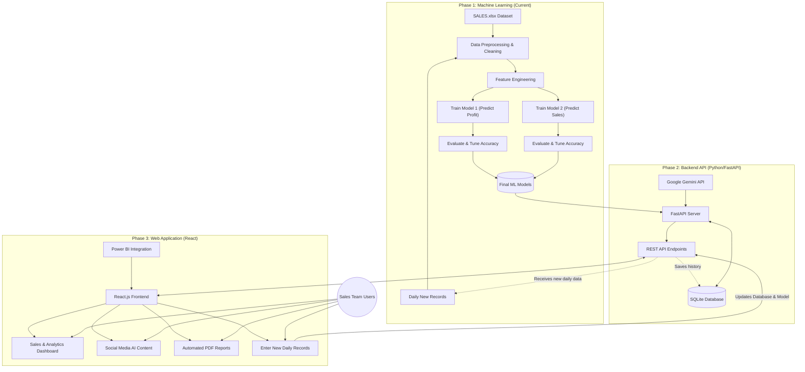

# Project Flowchart

Here is the visual flow of how the entire platform will be built and how the different components (Machine Learning, Backend, Frontend, and APIs) interact with each other. This includes the newly added **Continuous Learning** loop.

> [!NOTE]
> We are currently at the very top of **Phase 1**. The immediate next step is to write the Python code for **Data Preprocessing & Cleaning**, and then proceed to train the models for both Profit and Sales.
